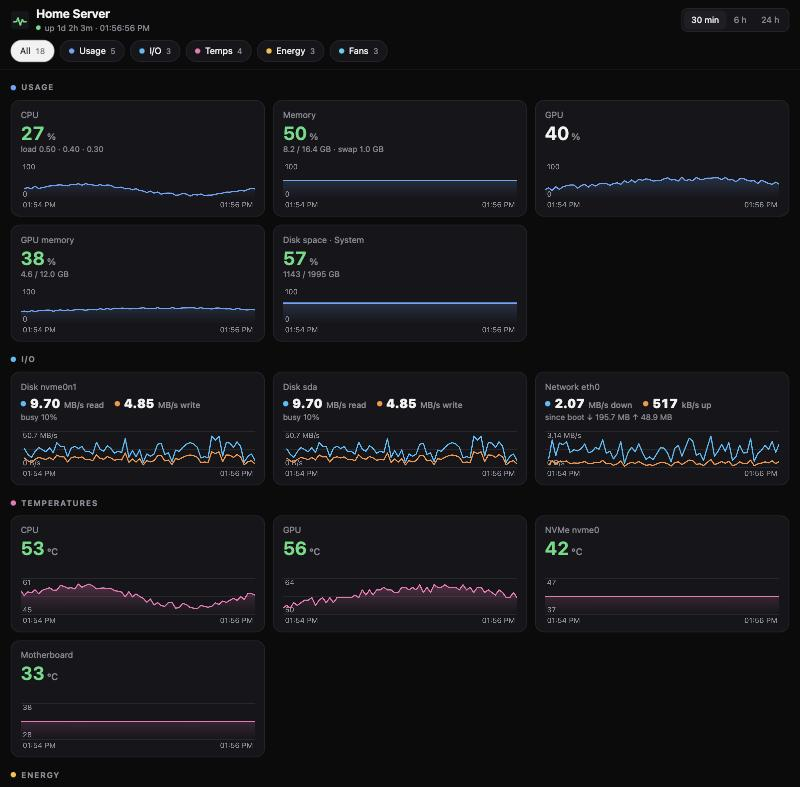

# server-monitor

A small, dependency-free hardware monitor for a Linux home server, with a
dashboard that works well on a phone.



- **Usage**: CPU, memory, GPU, GPU memory, disk space (one disk or all of them)
- **I/O**: read/write per disk, download/upload per network interface
- **Temps**: CPU, GPU, NVMe, SATA drives, motherboard, plus any sensor you add
- **Energy**: CPU package and GPU power (measured when possible) and an
  estimate of the whole system's draw at the wall, with kWh and cost for the last 24 h
- **Fans**: RPM of every connected fan header, GPU fan speed

Category chips (All · Usage · I/O · Temps · Energy · Fans) filter the page,
with history views for 30 min, 6 h and 24 h. It uses one Python process from
the standard library and a few hundred lines of plain JavaScript, with no
database or agents. Hardware is auto-detected, so you only configure what you
want to rename or tune.

## Quick start

Requirements: Linux, Docker. NVIDIA GPU support needs the
[NVIDIA Container Toolkit](https://docs.nvidia.com/datacenter/cloud-native/container-toolkit/latest/install-guide.html).

```bash
curl -O https://raw.githubusercontent.com/mediadnan/server-monitor/main/docker-compose.yml
```

```bash
MONITOR_PASSWORD='choose-a-long-password' docker compose up -d
```

Open http://127.0.0.1:8088 on the server (or through an SSH tunnel:
`ssh -L 8088:127.0.0.1:8088 your-server`) and sign in as `admin`.

Without compose:

```bash
docker run -d --name server-monitor --restart unless-stopped \
  -p 127.0.0.1:8088:8088 -v /sys:/sys:ro -v server-monitor:/data \
  -e MONITOR_PASSWORD='choose-a-long-password' -e DATA_DIR=/data \
  --read-only --tmpfs /tmp --cap-drop ALL --security-opt no-new-privileges \
  ghcr.io/mediadnan/server-monitor:latest
```

Add `--runtime nvidia -e NVIDIA_VISIBLE_DEVICES=all -e NVIDIA_DRIVER_CAPABILITIES=utility`
for an NVIDIA GPU.

### Coolify

1. Create a new resource → **Docker Compose Empty** and paste
   [docker-compose.yml](docker-compose.yml), with your own environment values.
2. Coolify lists `MONITOR_PASSWORD` under **Environment Variables**. Set it
   there and lock it so it is treated as a secret.
3. Deploy. To expose it on a domain, set the domain on the service and
   Coolify's proxy will add HTTPS. Keep `MONITOR_PASSWORD` set when you do.

Image tags: `latest` follows `main`, `sha-<commit>` pins an exact build, and
`1.0` / `1.0.0` follow release tags.

## Configuration

Everything is optional except the password, which you need whenever the
dashboard can be reached by anyone but you.

| Variable | Default | Description |
|---|---|---|
| `MONITOR_PASSWORD` | *(empty = no auth)* | Password for HTTP basic auth. Keep it in a secret store, not in git. |
| `MONITOR_USER` | `admin` | Username for basic auth. |
| `MONITOR_TITLE` | `Server Monitor` | Page title and header. |
| `DATA_DIR` | *(empty)* | Directory where history is saved every 5 min and on shutdown, so a restart keeps the 24 h view. |
| `PORT` | `8088` | Port to listen on inside the container. |
| `INTERVAL` | `2` | Seconds between samples. |
| `FAN_LABELS` | *(auto)* | `fan2=CPU fan,fan4=Rear fan`. When set, **only** these fans are shown, in this order. Use `chip/fanN` (for example `nct6798/fan2`) if two chips have the same channel. When unset, every header that has spun at least once is shown as "Fan N". |
| `EXTRA_TEMPS` | *(none)* | Extra temperature sensors: `Chipset=nct6798/temp3,VRM=nct6798/temp5`. |
| `NET_IFACES` | *(auto)* | Interfaces to show, for example `eth0,wlan0`. By default only physical NICs (docker bridges, veth and VPN tunnels are skipped). |
| `DISKS` | *(auto)* | Disks to show I/O for, for example `nvme0n1,sda`. By default every whole disk with activity. |
| `DISK_PATHS` | `System=/` (none with `HOST_ROOT`) | Filesystems for the disk-space tiles, as `label=path` inside the container. To add a single data drive, mount it read-only (`/mnt/data:/disks/data:ro`) and add `Data=/disks/data`. To show every disk, use `HOST_ROOT` instead. |
| `HOST_ROOT` | *(empty)* | Where the host's `/` is mounted in the container, for example `/hostfs`. Shows a disk-space tile for every mounted disk. See [All disks](#all-disks). |
| `DISK_LABELS` | *(mountpoint name)* | Names for those tiles by host mountpoint: `/srv/data=Data,/mnt/backup=Backup`. The host's `/` is called "System". |
| `DISK_EXCLUDE` | *(none)* | Host mountpoints to hide, for example `/boot,/boot/efi`. |
| `CPU_IDLE_W` | `10` | CPU power at idle, used only when RAPL can't be read. |
| `CPU_MAX_W` | `65` | CPU power at 100 % load (≈ its TDP/PPT), used only when RAPL can't be read. |
| `BASE_W` | `20` | Everything else (motherboard, RAM, drives, fans), DC side. |
| `PSU_EFF` | `0.85` | PSU efficiency, either a number or a load curve like `10:0.80,20:0.87,50:0.90,100:0.87` (percent of rated load : efficiency). |
| `PSU_WATTS` | *(empty)* | Rated PSU output. Needed for a `PSU_EFF` curve. |
| `ENERGY_PRICE` | *(empty)* | Price per kWh, to show the cost of the last 24 h. |
| `CURRENCY` | *(empty)* | Shown after the cost, for example `EUR`. |

### All disks

By default the disk-space tile shows the disk that holds Docker's data. To
see every disk, mount the host's root read-only and tell the monitor where:

```yaml
    volumes:
      - /:/hostfs:ro,rslave
    environment:
      HOST_ROOT: /hostfs
      DISK_LABELS: "/srv/data=Data,/mnt/backup=Backup"   # optional
      DISK_EXCLUDE: "/boot/efi"                          # optional
```

The monitor reads the host's mount table and shows one tile per filesystem
on a block device. Snaps (loop devices), tmpfs, overlay and other virtual
filesystems are skipped, and so are bind mounts and subvolumes of a disk
that already has a tile. The note under each tile names the physical
disk(s), through partitions, LUKS, LVM and md RAID (for example
`412 / 916 GB · nvme0n1`). The tile for the host's `/` keeps the id
`space_system`, so its history carries on from the default setup.

`rslave` lets the container see disks mounted after it started, such as an
encrypted drive unlocked by hand. Without it, restart the container after
mounting a disk. A disk the container can't see is left out rather than
shown with the wrong numbers.

To check which disks the host has: `findmnt -rno TARGET,SOURCE,FSTYPE`.

### Finding sensor names

```bash
for h in /sys/class/hwmon/hwmon*; do echo "$h: $(cat $h/name)"; ls $h | grep -E '^(temp|fan)[0-9]+_(input|label)$' | tr '\n' ' '; echo; done
```

`sensors` (lm-sensors) also helps match a fan header to a channel: stop a fan
briefly or change its curve in the BIOS and see which `fanN` changes.

Motherboard fan and temperature sensors need the Super I/O driver loaded on
the host (often `nct6775` or `it87`). If no fans appear, run
`sudo sensors-detect` on the host.

## How energy is measured

| Part | Source | Accuracy |
|---|---|---|
| GPU | The card's own sensor (`nvidia-smi`, or `amdgpu` hwmon) | measured, board power |
| CPU | RAPL package energy counters (Intel, AMD Zen on recent kernels) | measured, package only |
| CPU (fallback) | `CPU_IDLE_W + (CPU_MAX_W − CPU_IDLE_W) × load` | rough |
| Rest | `BASE_W` | constant |
| Wall | `(CPU + GPU + BASE_W) / PSU efficiency` | usually within 10–20 % |

Each energy tile is labelled *measured* or *est.* The kWh figure under
"System at the wall" integrates the estimate over the last 24 hours.

**Calibrating with a plug-in power meter:** let the server idle, read the
meter, and change `BASE_W` until "System at the wall" matches. Then put it
under load (a game, a model, `stress -c N`) and check again. If it is off
under load only, the PSU efficiency is the culprit: set `PSU_WATTS` and a
`PSU_EFF` curve from your PSU's 80 PLUS report. Typical 230 V curves are
Bronze `20:0.85,50:0.88,100:0.85`, Gold `10:0.82,20:0.90,50:0.92,100:0.89`,
Platinum `10:0.85,20:0.92,50:0.94,100:0.90`.

## Security

- **Auth:** set `MONITOR_PASSWORD` unless the port is only reachable by you.
  Credentials are checked in constant time and failed attempts are slowed
  down. Basic auth sends the password with every request, so only expose the
  dashboard over HTTPS (Coolify, Caddy, Traefik, nginx) or a VPN.
- **`/healthz`** is the only unauthenticated route. It returns `ok` and no data.
- **Container:** the image runs as root so it can read the RAPL counters
  (root-only since a 2020 side-channel fix). The example compose file drops all
  Linux capabilities, makes the filesystem read-only and sets
  `no-new-privileges`, so the process can read files and serve HTTP and do little else.
  If you don't need measured CPU power, add `user: "65534:65534"`.
- **Mounts:** by default `/sys` read-only is the only host mount besides the
  data volume. With [All disks](#all-disks) the host's `/` is mounted
  read-only as well. Docker makes that recursive on kernel 5.12+, but a disk
  mounted on the host *after* the container started can arrive through
  `rslave` with its own write flag, so restart the container after mounting
  disks if that matters to you. Because the process runs as root, it can
  read root-only files on the host, such as `/etc/shadow` or other
  containers' secrets. With `user: "65534:65534"` it can only read what any
  user on the host can, and disk space still works, but CPU power becomes
  an estimate.
- **Browser:** strict Content-Security-Policy (no inline scripts, no third-party
  requests), `X-Frame-Options: DENY`, `no-referrer`, `noindex`.
- **Repository:** contains no hardware- or host-specific values. Keep yours in
  your deployment's environment variables.

## API

All routes except `/healthz` require auth when a password is set.

| Route | Returns |
|---|---|
| `GET /api/now` | `{ts, rev, v: {key: value}, notes: {tile: text}, info: {uptime}}` |
| `GET /api/tiles` | `{rev, title, groups, tiles: [...]}`: what the dashboard draws |
| `GET /api/history?tier=fast` | Last 30 min at 2 s: `{t: [...], series: {key: [...]}}` |
| `GET /api/history?tier=slow` | Last 24 h at 30 s averages |
| `GET /healthz` | `ok` |

## Development

```
monitor/
  __main__.py        entry point (python -m monitor)
  config.py          environment variables -> Config
  monitor.py         sampling loop, tile registry, persistence
  history.py         30 min / 24 h ring buffers
  server.py          HTTP server, auth, security headers
  sample.py          Tile and Sample types
  collectors/        one module per data source
    system.py        CPU, memory, disk space
    io.py            disk and network throughput
    hwmon.py         temperatures, fans, AMD GPU
    nvidia.py        NVIDIA GPUs
    power.py         RAPL and the power model
  web/               index.html, app.js, style.css
tests/               unit tests against a fake /sys and /proc
```

```bash
python -m unittest -v
```

To add a sensor, write a collector with `collect(sample)` that calls
`sample.tile(Tile(...))` and `sample.set(key, value)`, then add it to
`collectors/__init__.py`. The dashboard picks up new tiles automatically.

## License

MIT
